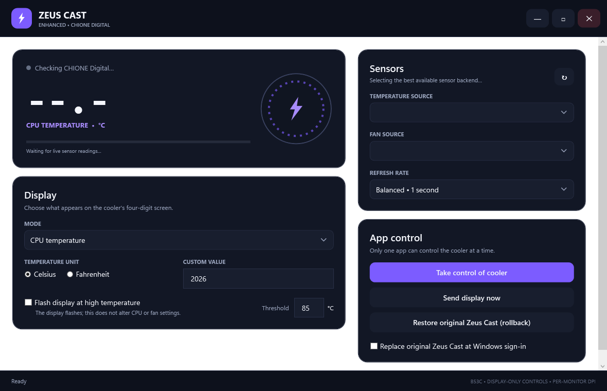

# Zeus Cast Enhanced

An unofficial, modern Windows controller for the GAMDIAS CHIONE Digital four-digit cooler display (`VID_1B80`, `PID_B53C`).



## Features

- Live CPU/package temperature with Celsius or Fahrenheit output
- Fan and pump RPM when exposed by the motherboard sensor controller
- Automatic cycling between temperature and fan speed
- Custom four-digit display values
- Configurable high-temperature flashing
- GAMDIAS CPUID sensor backend with LibreHardwareMonitor fallback
- Automatic USB reconnection and sensor rescanning
- Session minimum/maximum temperature and RPM statistics
- System tray operation with a live temperature/RPM tooltip
- Elevated background startup that replaces the original Zeus Cast startup
- One-click rollback to the original application
- Per-monitor DPI awareness and a resizable modern WPF interface

## Supported display and limitations

This project currently targets the CHIONE Digital display with USB ID `1B80:B53C`.

The B53C protocol exposes four numeric positions plus flags for the decimal point, Celsius/Fahrenheit, CPU/fan mode, and flashing. The display cannot receive pictures, arbitrary text, animations, RGB colours, or orientation commands. Its segment colours and printed indicators are fixed in hardware. The application does not change CPU voltage, clocks, fan curves, pump speed, BIOS settings, or lighting controllers.

## Quick install from source

### Requirements

- Windows 10 or Windows 11, x64
- [.NET 9 SDK](https://dotnet.microsoft.com/download/dotnet/9.0)
- A connected CHIONE Digital cooler display
- The official GAMDIAS Zeus Cast package installed is strongly recommended for its device drivers and optional sensor SDK

### Install

1. Download this repository as a ZIP or clone it with Git.
2. Exit any running Zeus Cast Enhanced instance from its tray icon.
3. Double-click **`Install.cmd`**.
4. Approve the Windows administrator prompt when the installed application starts.

The installer creates a self-contained x64 build in:

```text
%LOCALAPPDATA%\Programs\ZeusCastEnhanced
```

It also creates Desktop and Start Menu shortcuts. On first launch, Enhanced closes the original Zeus Cast, creates its own elevated sign-in task, disables the original task, and starts monitoring the cooler.

The proprietary `cpuidsdk64.dll` file is intentionally not included in this repository or release archives. Enhanced loads it directly from an existing official Zeus Cast installation when available. Without it, LibreHardwareMonitor is used as the fallback sensor backend.

## Everyday use

- **Minimize or close:** the window hides while monitoring continues in the system tray.
- **Open:** click or double-click the Zeus Cast tray icon.
- **Exit completely:** right-click the tray icon and select **Exit**.
- **Change display:** select CPU temperature, fan speed, automatic cycling, or a custom value.
- **Restore vendor app:** select **Restore original Zeus Cast (rollback)** inside Enhanced.
- **Keep the tray icon visible:** use Windows **Show Hidden Icons** and move Zeus Cast Enhanced into the visible tray area.

User settings are stored at:

```text
%LOCALAPPDATA%\ZeusCastEnhanced\settings.json
```

## Build for development

Run:

```powershell
.\Build.cmd
```

Or use the .NET CLI directly:

```powershell
dotnet restore .\ZeusCastEnhanced.sln
dotnet build .\ZeusCastEnhanced.sln -c Release
```

Run the app from source:

```powershell
dotnet run --project .\app\ZeusCastEnhanced.csproj -c Release -p:Platform=x64
```

The application requests administrator rights because low-level CPU and motherboard sensor access requires elevation.

## Diagnostics

Run the diagnostic utility from an administrator terminal:

```powershell
dotnet run --project .\diagnostics\ZeusCastDiagnostics.csproj -c Release
```

It reports elevation, active sensor backend, detected temperatures/fans, cooler connectivity, and whether a display write can be attempted safely.

## Create a release ZIP

Run:

```powershell
.\Package-Release.cmd -Version 1.0.0
```

The self-contained Windows x64 package and its SHA-256 checksum are written to `artifacts`. The GAMDIAS SDK is never included.

## Uninstall

Double-click:

```text
Uninstall.cmd
```

Approve the administrator prompt. The script removes Enhanced, deletes its scheduled task and shortcuts, then restores the original Zeus Cast startup entries.

## How it works

- `app/Services/ChioneHidService.cs` sends 65-byte HID output reports to `VID_1B80 / PID_B53C`.
- `app/Services/CpuidSdkNative.cs` dynamically loads the optional official GAMDIAS sensor SDK from the vendor installation.
- `app/Services/HardwareMonitorService.cs` selects the best sensor backend and falls back to LibreHardwareMonitor.
- `app/Services/StartupOverrideService.cs` manages exclusive control and Windows startup replacement.
- `app/MainWindow.xaml` and `app/MainWindow.xaml.cs` implement the DPI-aware interface, tray behavior, display modes, reconnection, and session statistics.

Only one application should write to the display at a time. Enhanced stops the original Zeus Cast before connecting to prevent conflicting HID reports.

## Troubleshooting

### Temperature or RPM is blank

- Confirm the app is running as administrator.
- Exit the original Zeus Cast completely.
- Press the sensor refresh button in Enhanced.
- Install the official Zeus Cast package so its signed sensor components are available.
- Some motherboard controllers do not expose fan or pump RPM to Windows software.

### Cooler is not detected

- Reconnect its internal USB cable.
- Confirm Device Manager detects the cooler.
- Verify the device uses USB ID `1B80:B53C`.
- Ensure no other cooler-control application is holding the HID interface.

### App appears to disappear

It is probably still running in the Windows system tray. Open **Show Hidden Icons**, then click the Zeus Cast Enhanced icon.

### Restore the original application

Use the rollback button inside Enhanced or run `Uninstall.cmd`.

## Push to GitHub

Create an empty repository on GitHub, then run these commands from this folder:

```powershell
git init
git add .
git commit -m "Initial public release"
git branch -M main
git remote add origin https://github.com/YOUR-NAME/ZeusCastEnhanced.git
git push -u origin main
```

## Privacy and safety

The application does not send telemetry and does not require network access. It only reads local hardware sensors, stores settings under the current Windows profile, and writes supported values to the cooler's USB display. Review `THIRD-PARTY-NOTICES.md` for dependency and vendor-SDK information.

## License

Zeus Cast Enhanced is available under the MIT License. See `LICENSE`.

This is an independent community project and is not affiliated with or endorsed by GAMDIAS.
